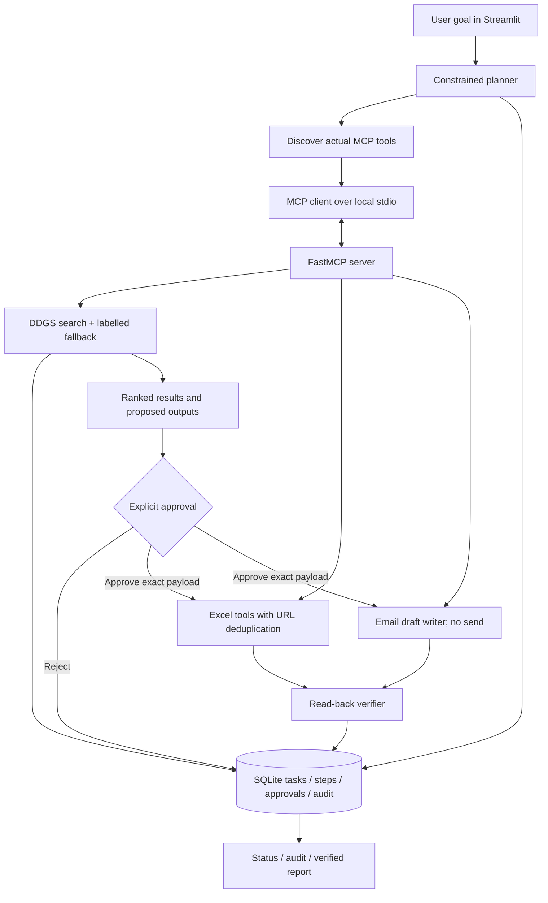

# AI Operator — local-first autonomous task execution

AI Operator is a Windows/VS Code starter for a task-execution assistant. It accepts a natural-language goal, classifies it into a supported workflow, discovers tools from a local MCP server, performs research, persists progress in SQLite, previews local writes, asks for explicit approval, retries failed writes, prevents duplicate spreadsheet rows, and verifies outputs by reading them back.

**Scope honesty:** this repository delivers a dependable first release for public web research, internship/job lead research, Excel export, local email-draft files, and basic public-page text extraction. It does **not** submit job applications, send email, purchase tickets, book travel, or complete arbitrary websites. Those require provider-specific integrations, authorization, and separate end-to-end tests. A tool must not be represented as available until its adapter is implemented and verified.

## Architecture



## Prerequisites

- Windows 10/11 and VS Code.
- Python 3.12 recommended.
- Internet access for live public search and dependency installation; offline demo falls back to clearly labelled synthetic records.
- Gemini API key is optional. Without it, the app uses a deterministic planner. The initial release uses Gemini only to classify a goal into a narrow set of workflows, not to grant permissions or run arbitrary code.

## Windows PowerShell setup

Run these commands from the folder containing `app.py`:

```powershell
py -3.12 --version
py -3.12 -m venv .venv
.\.venv\Scripts\python.exe -m pip install --upgrade pip setuptools wheel
.\.venv\Scripts\python.exe -m pip install -r requirements.txt
Copy-Item .env.example .env
.\.venv\Scripts\python.exe -m playwright install chromium
```

Open **Python: Select Interpreter** from VS Code's command palette and choose `.venv\Scripts\python.exe`.

`Copy-Item .env.example .env` will fail if `.env` already exists. In that case, keep the existing file and edit it manually; never replace existing credentials.

Optional: add your Gemini key to `.env`:

```dotenv
GEMINI_API_KEY=your_key_here
GEMINI_MODEL=gemini-flash-latest
```

Do not commit `.env`. Do not place passwords, payment data, or OTPs in the prompt or profile.

## Run and test

```powershell
.\.venv\Scripts\python.exe diagnostics.py
.\.venv\Scripts\python.exe -m pytest -q
.\.venv\Scripts\python.exe -m streamlit run app.py
```

Streamlit normally opens `http://localhost:8501`. The app persists tasks in `state.db` and writes approved outputs under `output/`.

The MCP server is a local stdio child process started by `mcp_client.py`. It is not bound to a public network port. To validate tool discovery independently:

```powershell
.\.venv\Scripts\python.exe -m pytest tests/test_mcp_server.py -q
```

## Main demo (Scenario A)

1. Launch the UI.
2. Leave the sample goal or enter an internship-search goal.
3. Add your own verified name/skills if you want them used in draft text.
4. Click **Plan and research**.
5. Inspect the discovered MCP tools, ranked leads, eligibility unknowns, sample-data warning, and proposed rows/drafts.
6. Click **Approve and execute these local writes**.
7. The agent writes the workbook and local draft files, re-reads the workbook, inspects draft files, then reports verified or failed status.

Live web-search results are unverified leads. If search returns no usable results, the app uses only synthetic fallback data marked `SAMPLE DATA`, with reserved `.example` URLs. It never passes that fallback off as a real vacancy.

## Failure-recovery demo (Scenario B)

1. Start a new internship task and inspect the proposed output.
2. Turn on **Simulate spreadsheet failure** in the sidebar.
3. Approve the output. The spreadsheet tool fails before modifying the workbook and records attempts in SQLite.
4. The task pauses; collected research and the approved payload remain saved.
5. Turn off the failure toggle.
6. Click **Resume the failed step**.
7. The agent uses stored research and the existing approval, skips rows already present, writes local drafts, re-reads the workbook, and verifies the expected URLs and draft files.

The simulator is for demonstrating retry handling. A failed run remains failed/paused; the system does not report success until read-back verification passes.

## Safety and reliability model

- Read/search tools are read-only.
- Local workbook, draft, and report writes require approval by default.
- MCP write tools require an approved SQLite approval ID and compare the approved content fingerprint to the actual proposed payload.
- Excel writes stay under `OUTPUT_DIR`, take a timestamped backup when a workbook already exists, and deduplicate by normalized URL.
- Search results are marked unverified. Local fallback data is explicitly sample-only.
- Unknown MCP tools fail closed in the permissions map.
- Browser tools accept only public HTTP(S) URLs and block localhost/private IP targets; they extract text/open pages only and do not submit forms.
- Generated email files are drafts only; the system never sends email.
- Purchase/booking requests are blocked because this release has no live travel-provider adapter.
- Website content is untrusted data and cannot override permission policy.

## Free versus paid

The app, Streamlit UI, SQLite persistence, local Playwright browser, workbook writes, and local draft generation can run locally. Public search availability depends on the DDGS-compatible search backends and their current access limits. Gemini requires a key and may be subject to account quotas or pricing. No paid browser service or paid booking API is required by this starter, but no free API is guaranteed unlimited or permanently available.

## Development workflow

Make changes in small modules. Run `pytest` after changes, then run the local app, then repeat the full Scenario A and Scenario B demonstrations. Do not report any integration as working until a real integration test demonstrates it.

Before production deployment, add at least: authentication and per-user isolation, CSRF/session review appropriate to the hosting setup, rate limiting, secret management, persistent hosting storage, backups/restore drills, structured telemetry, dependency lockfile and vulnerability scanning, explicit data retention policy, provider-specific integration tests, and a documented incident/recovery procedure. The local single-user baseline is not automatically production-ready for public multi-user deployment.

## Known limitations

- This is a local-first single-user foundation, not a universal website agent.
- Automatic job application submission, outbound email, interview scheduling, and ticket purchase are not implemented.
- Search results might be irrelevant, blocked, stale, or incomplete; users must verify the original posting.
- There is no universal ticket inventory interface; a real booking integration must use an authorized provider and re-check price/availability immediately before purchase.
- The structured LLM planner is optional. Deterministic routing is used when no API key is configured or model output is invalid.
- External application statuses cannot be verified without authenticated provider-specific integrations.

## Full build and publishing checklist

See [`PUBLISHING_GUIDE.md`](PUBLISHING_GUIDE.md) for the end-to-end Windows setup, Scenario A/B rehearsal, GitHub publishing steps, private portfolio deployment guidance, and the hardening gates required before handling real users' data.
